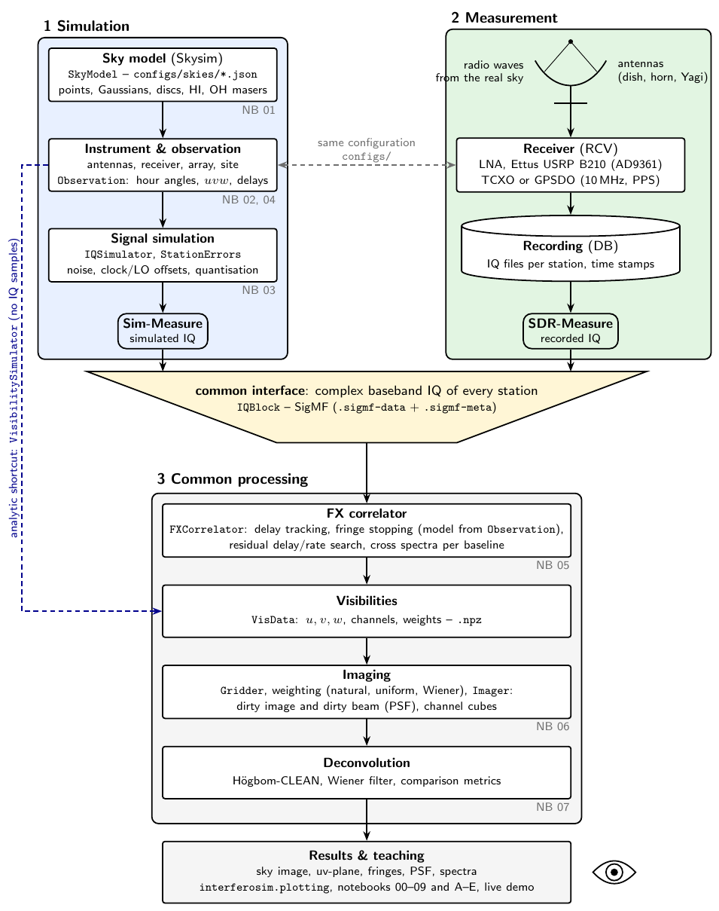

.. docs/sphinx/index.rst -- start page of the Interferosim documentation
.. 2026-11-16: chapter "Introduction and workflow" (introduction.rst) added to the user guide;
   workflow figure as overview at the beginning

Interferosim
============

An open-source simulator for radio interferometry -- from a two-element
system up to small arrays -- with interactive Jupyter notebooks for
teaching. A project of the University of Vienna.

Overview
--------

Interferosim follows the signal from the sky to the image. A simulated
observation (branch 1) and a real measurement with SDR receivers (branch 2)
both deliver IQ samples of every station; from there on correlation,
imaging and deconvolution are the same (block 3). The chapter
:doc:`introduction` explains each step.

         IQ interface, correlator, visibilities, imaging, deconvolution
   :width: 70%
   :align: center
   :target: introduction.html

   The Interferosim workflow (click for the introduction chapter).

.. image:: ../images/sky_gallery.png
   :alt: Example skies of Interferosim

**Status:** |release| -- sky models (:mod:`interferosim.sky`), the
instrument (:mod:`interferosim.instrument`: antennas, receiver, array) and
the signal simulation (:mod:`interferosim.signal`: IQ samples of every
station) are implemented; observation, imaging and deconvolution are being
migrated from
``aas6sim`` and the teaching notebooks step by step.

.. toctree::
   :maxdepth: 2
   :caption: User guide

   introduction
   interferometer
   installation
   quickstart
   sky
   instrument
   notebooks

.. toctree::
   :maxdepth: 2
   :caption: Reference

   api
   changelog

Indices
-------

* :ref:`genindex`
* :ref:`modindex`
